<div align="center">

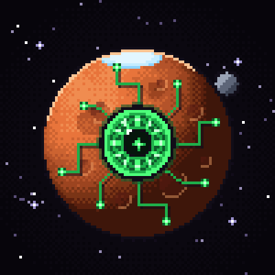

# MARS MIND

**BUILD THE COLONY. COMMAND THE AI. SURVIVE MARS.**

A pixel-art Mars colony you run in plain language.
You give the order, **CORE** plans it, robots physically build it.

[](https://app.netlify.com/start/deploy?repository=https://github.com/breakablespec/MarsMindGame)
&nbsp;
[](https://x.com/MarsMindGame)


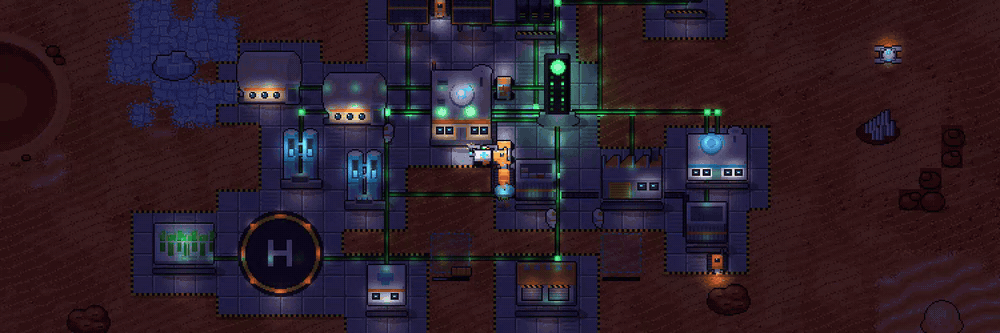

</div>

<br>

<div align="center">
</div>

<br>

## One command, start to finish

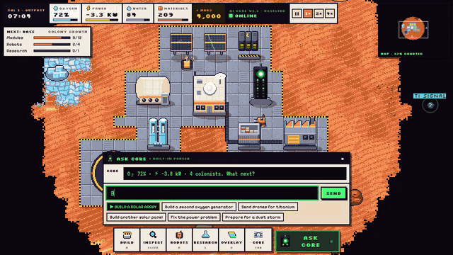

Nothing appears by magic. When you ask for a second oxygen generator, CORE checks the stock, finds it is **2 polymer short**, and says so. Approve the plan and you watch every step happen on the map:

| | What happens | Who does it |
|:-:|---|---|
| 1 | Workshop turns ice + regolith into the missing polymer | Workshop, conveyors |
| 2 | Titanium, polymer and electronics are hauled to the blueprint | `BUILDER-01` |
| 3 | Foundation → frame → cladding | `BUILDER-01` |
| 4 | Cable and oxygen pipe are run to the grid | `BUILDER-01` |
| 5 | **OXYGEN CAPACITY +44% · +6 O₂/h** | the colony |

<br>

## When Mars fights back

<table>
<tr>
<td width="58%">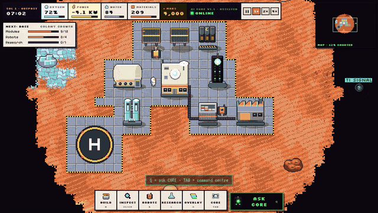</td>
<td>

**Dust storm.** Solar drops by up to 75%, robots slow down, panels get dusty.

Say **"Keep everyone alive"** and CORE builds an emergency plan from the colony's live state:

- recall robots before the storm
- top up the oxygen generator hopper
- pause lighting and research
- hold power for life support
- resume work when the sky clears

Also on the forecast: power failures, oxygen leaks, robot breakdowns, meteors, solar storms, cold nights, storage overload.

</td>
</tr>
</table>

<br>

## The numbers are real

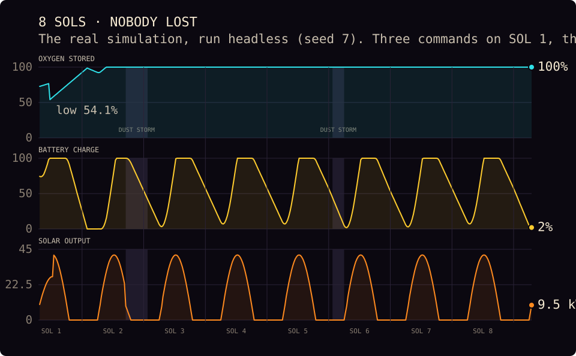

Every value on the HUD comes from the simulation, nothing is decorative. This chart is a headless run of the same code the game ships: three commands on SOL 1, then CORE runs the colony through two dust storms. Oxygen dips while the second generator is built, then stays full. The battery fills every day and is nearly empty by dawn, which is exactly why CORE keeps suggesting another battery bank.

<br>

## How CORE thinks

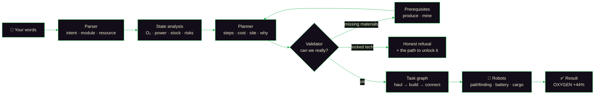

- **No fake numbers.** Costs, build times, power and the predicted effect are computed from the colony's state.
- **No faked actions.** "Build a reactor" before the research is done gets a clear no, plus the way to unlock it.
- **No hidden reasoning dump.** CORE shows a short plan: steps, cost, location and why.
- **Works offline.** A built-in parser understands the game's commands. When the page runs inside Claude, Claude can read freer phrasing too, and every answer still goes through the same validator.

<br>

## The loop

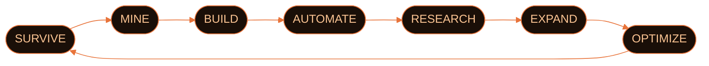

**OUTPOST → BASE → COLONY → SETTLEMENT → CITY.** Each stage unlocks new modules, harder weather and bigger shuttles.

<br>

## Modules

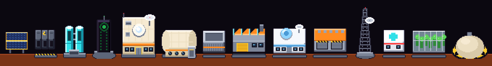

| Life support | Power | Industry | Science & growth |
|---|---|---|---|
| Habitat · Oxygen generator · Medical · Greenhouse | Solar array · Battery bank · Wind turbine · Reactor · Geothermal tap | Storage · Workshop · Robot bay · Mining outpost | Space lab · Comm tower |

Production chains are short and physical: **ice → water → O₂**, **regolith → silica**, **ice + regolith → polymer**, **rare + silica → electronics**.

<br>

## The fleet

<div align="center">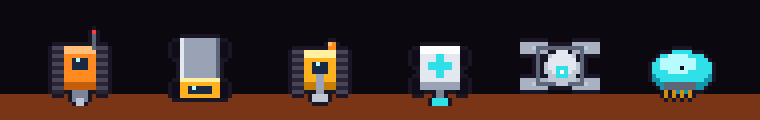</div>

| | Robot | Speed | Cargo | Job |
|:-:|---|:-:|:-:|---|
| 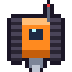 | **Miner** | 2.2 | 30 | Drills deposits and brings the ore home |
|  | **Hauler** | 2.8 | 40 | Moves materials between storage, sites and hoppers |
| 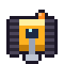 | **Builder** | 2.4 | 15 | Assembles and connects modules, repairs slowly |
| 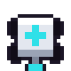 | **Repair** | 2.6 | 10 | Seals leaks, fixes modules, tows dead robots |
| 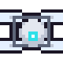 | **Scout drone** | 4.5 | — | Flies over terrain, clears fog, surveys deposits |
| 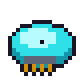 | **Maintenance drone** | 3.5 | 10 | Cleans solar panels, keeps hoppers full |

Every robot has battery, condition, cargo, a current task and efficiency. They path around rocks and craters, return to charge, wear out, and break down. Want to do it yourself? Press **DRIVE** and steer one with WASD.

<br>

## Screens

<table>
<tr>
<td width="50%">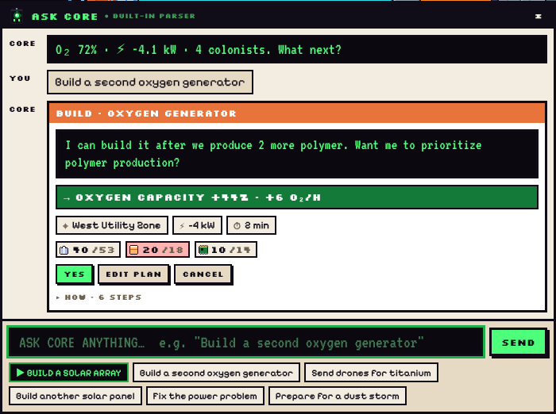<br><sub><b>ASK CORE.</b> A plan card: result, cost, site, power, time.</sub></td>
<td width="50%">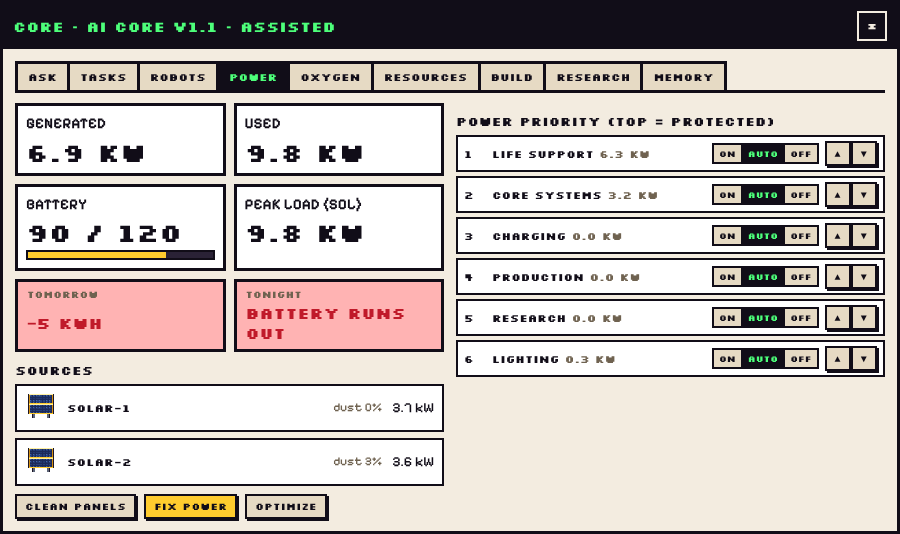<br><sub><b>Command centre.</b> Power priority, forecast, sources.</sub></td>
</tr>
<tr>
<td>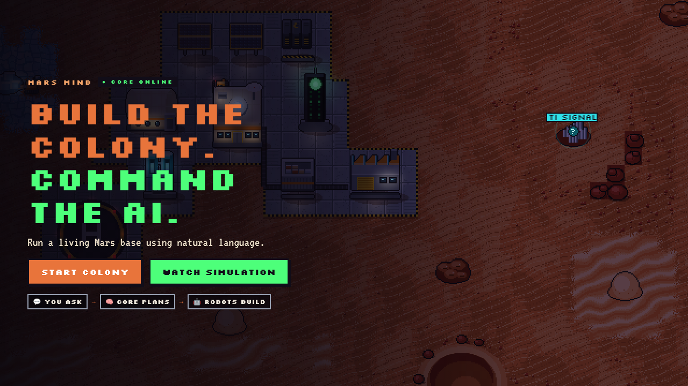<br><sub><b>Title.</b> START COLONY or WATCH SIMULATION.</sub></td>
<td align="center">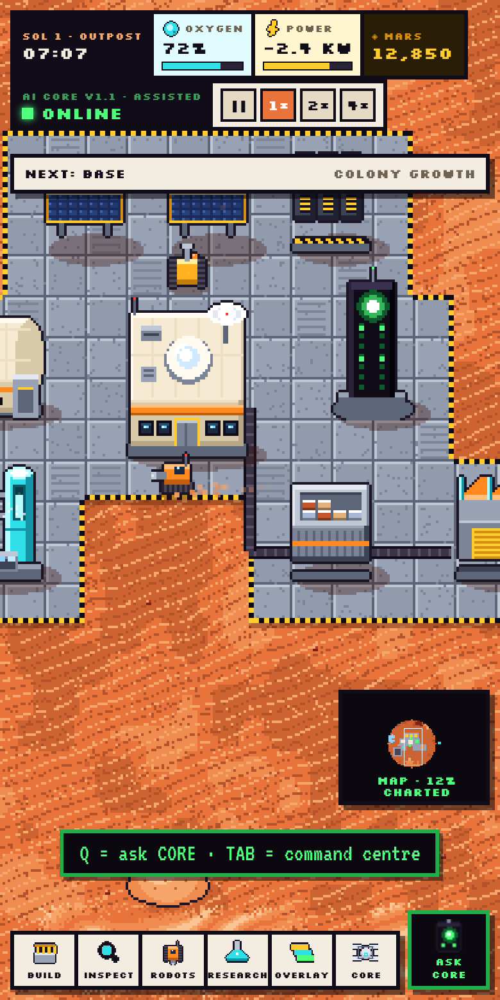<br><sub><b>Mobile.</b> Touch, pinch-zoom, the same game.</sub></td>
</tr>
</table>

<br>

## MARS tokens

<table>
<tr>
<td width="44%">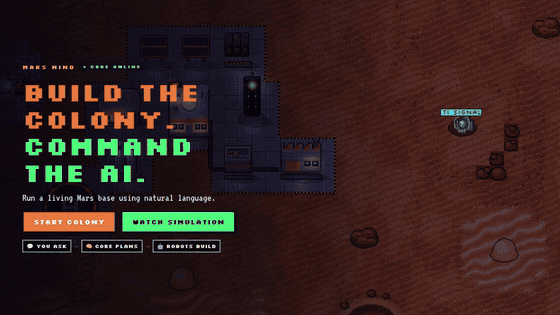</td>
<td>

**Sign in with X** and complete four quests to unlock the colony. Each one pays **+1,000 MARS**:

`FOLLOW` · `LIKE` · `REPOST` · `COMMENT`

Then you keep earning by playing:

| Event | MARS |
|---|--:|
| Module built | 50 |
| Robot built | 100 |
| Research complete | 150 |
| Sol survived | 100 |
| Dust storm survived | 200 |
| New colony stage | 1,000 |
| 12 one-time achievements | 250 – 2,000 |

</td>
</tr>
</table>

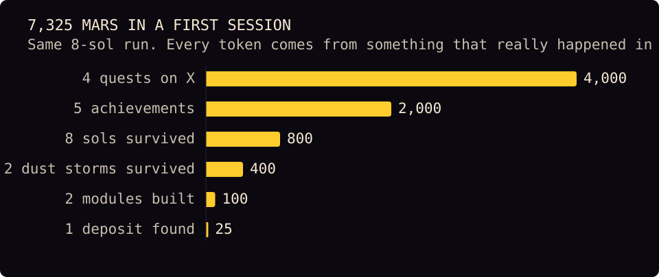

### Commander card

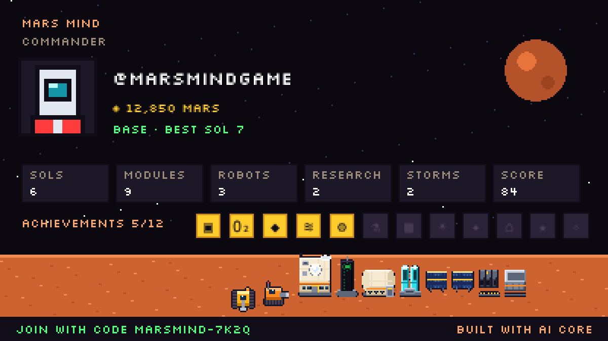

Every player gets a card built from their own stats: balance, sols, modules, robots, research, storms, score, achievement badges and their colony. **SAVE CARD** and **QUOTE ON 𝕏** share it with a personal referral link.

<br>

## Run it

```bash
git clone https://github.com/breakablespec/MarsMindGame.git
cd MarsMindGame
npm install
npm run build      # → dist/index.html, one self-contained file
npm test           # headless simulation + command tests
npm run dev        # build and serve locally
```

### Go live: Sign in with X + Supabase

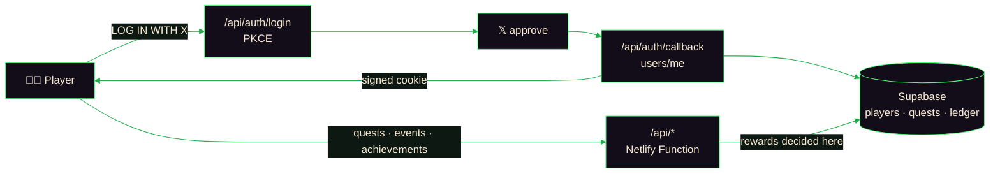

1. **Supabase:** run [`supabase/migrations/001_mars_mind.sql`](supabase/migrations/001_mars_mind.sql) in the SQL editor.
2. **Netlify:** import the repo. [`netlify.toml`](netlify.toml) builds the page and the `/api` function.
3. **X app:** OAuth 2.0, Web App, callback `https://YOUR-SITE/api/auth/callback`.
4. **Env vars:** `X_CLIENT_ID`, `X_CLIENT_SECRET`, `SUPABASE_URL`, `SUPABASE_SERVICE_ROLE_KEY`, `SESSION_SECRET`, `POST_URL`.

Step by step: **[SETUP.md](SETUP.md)**. Without the server (a plain file or `npm run dev`), the game falls back to typing an @handle and keeps everything in the browser.

<details>
<summary><b>Project structure</b></summary>

```
src/
├── sim/        pure simulation: colony state, power, life support, robots, tasks,
│               construction, logistics, research, weather, colony growth
├── ai/         CORE: parser → analysis → planner → validator, autonomy, learning
├── render/     Canvas 2D renderer, pixel sprites generated in code, lighting, fog
├── ui/         HUD, ASK CORE bar, command centre, quests gate, profile & card
├── account/    X login, quests, MARS balance, achievements, referrals (server or local)
├── audio/      synthesized sound effects and adaptive music
└── engine/     game loop, input, camera, DRIVE mode
netlify/        /api function: Sign in with X (OAuth 2.0 + PKCE), quests, rewards
supabase/       SQL: players, quests, ledger + reward functions (RLS on)
docs/           design docs: game loop, AI command architecture, robots, resources, art
tests/          headless runs: full flows, command parsing, late game, 8-sol soak
tools/          scene staging, README data and header rendering
```

</details>

<details>
<summary><b>Design docs</b></summary>

- [New game loop](docs/NEW_GAME_LOOP.md)
- [AI command architecture](docs/AI_COMMAND_ARCHITECTURE.md)
- [Robot system](docs/ROBOT_SYSTEM.md)
- [Resource system](docs/RESOURCE_SYSTEM.md)
- [Art direction](docs/ART_DIRECTION_SPACE.md)

</details>

<br>

<div align="center">
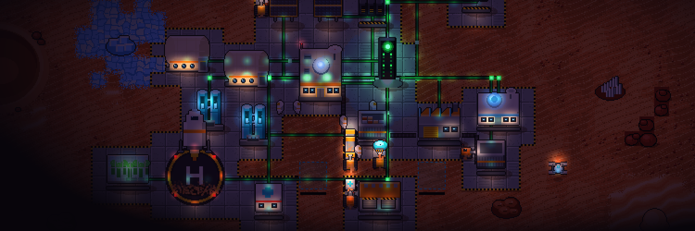

<br>

**BUILD THE COLONY. COMMAND THE AI. SURVIVE MARS.**

<sub>🔴 Made for Mars · follow <a href="https://x.com/MarsMindGame">@MarsMindGame</a></sub>
</div>
